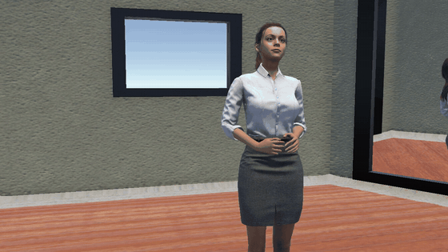
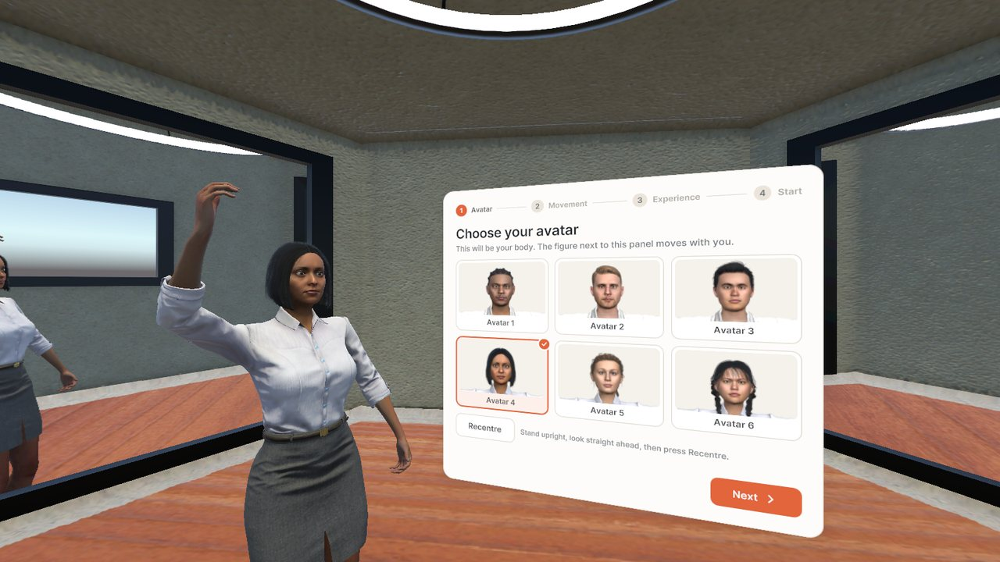
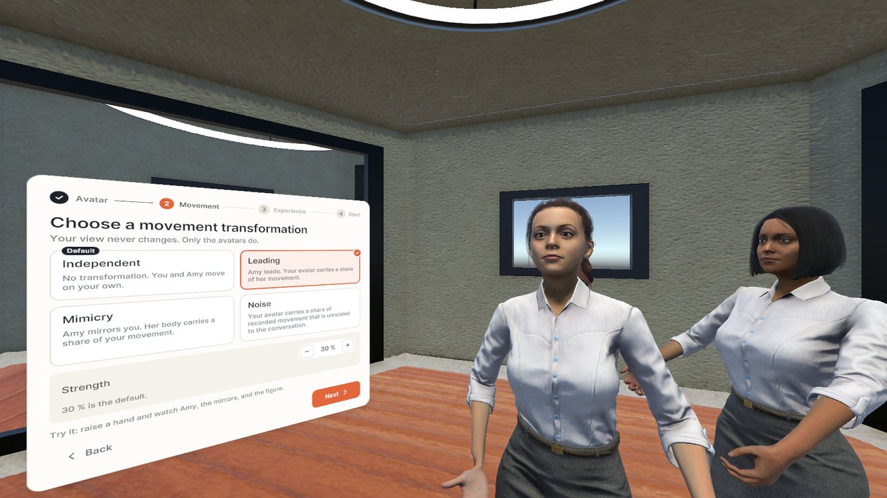
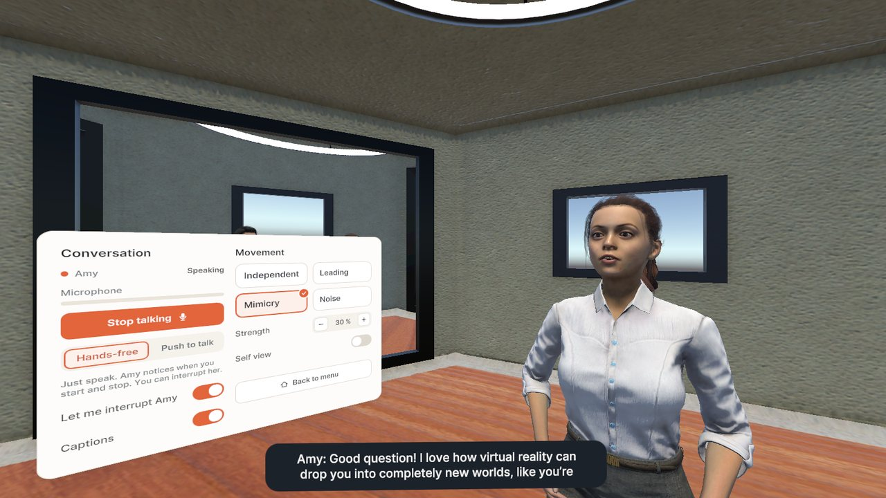
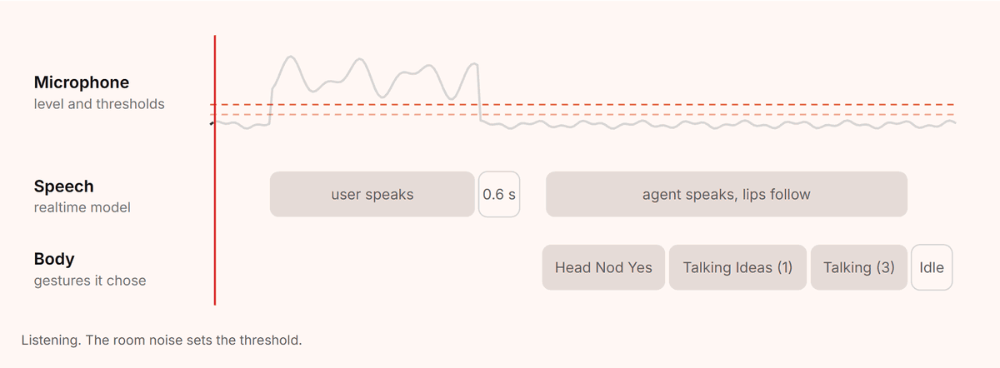
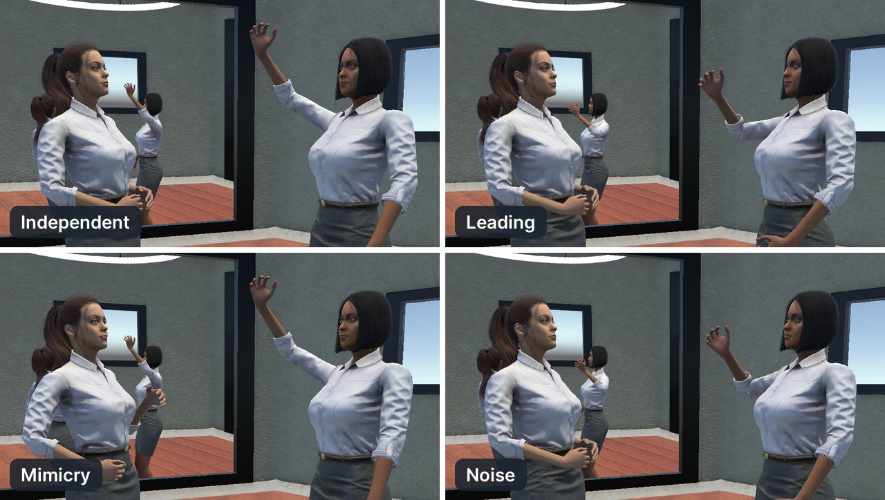

# Embodied AI Agent VR

A Unity platform for embodied AI in VR: a voice-to-voice LLM agent with OpenAI Realtime speech, LLM-selected gestures through function calling, lip sync, and a programmable movement transformation layer between user and agent.




*Captured in the Unity Editor without a live session: the gestures come from the agent's library and the mouth movement is simulated.*

[All-in-One](docs/ALL_IN_ONE.md) | [Architecture](docs/ARCHITECTURE.md) | [Components](docs/COMPONENTS.md) | [VR setup](docs/VR_SETUP.md) | [Customize](docs/CUSTOMIZE.md) | [Third-party notices](THIRD_PARTY_NOTICES.md) | [Changelog](CHANGELOG.md)

## What it does

- **Talks.** You speak and the agent answers, in real time, the way people do. There is no button to press and no wake word. The system hears when you begin and when you are done, the reply streams back as natural speech, and you can cut in whenever you like, as in any conversation.
- **Moves while it talks.** The agent responds to the situation with its body. It nods when it agrees, shakes its head when it does not, opens its hands to explain, waves, or pauses to think. The language model chooses from a large library of conversational movements what fits the moment, and it can line up several of them in one reply, so that the body follows the train of thought.
- **Facial animation.** The mouth moves with every sound. While the agent speaks, its voice is analysed frame by frame and shapes lips, teeth, and tongue. The eyes blink.
- **Movement transformation.** This is what is new here: movement modulation inside a conversational agent. A share of one body's movement can be laid over the other, live. The agent can take on some of your movement, and your avatar can take on some of the agent's.
- **Made to be reused.** Six user avatars, four movement modes, free conversation or a guided session, and an All-in-One scene in which everything can be chosen inside VR.

## All-in-One

One scene brings the platform together. Build it to a headset once, or press **Play** on a desktop, and choose everything inside: who you are, how movement is transformed, and what you want to do. The app never has to be restarted, and without an API key everything except the conversation still works.

| You choose | Options, default in bold |
| --- | --- |
| Avatar | One of six; your own body and a figure that moves like your reflection change at once |
| Movement | **Independent**, Leading, Mimicry, Noise |
| Strength | 0 to 100 percent, **30 percent** |
| Experience | **Free conversation**, or a full session with narration, boards, a warm-up, preparation time, and a timed conversation |
| Session | One of four topics; **about 8 minutes**, or a quick preview of about 3.5 minutes |
| Speaking | **Hands-free** or push to talk; interrupting the agent **on** or off |
| While it runs | Captions, self view, back to the menu. Free conversation: movement mode and strength. Session: pause, next step, restart |

| Choose an avatar | Choose a movement transformation |
| --- | --- |
|  |  |



*A live answer of the model, on a desktop. The side panel shows the state of the conversation and lets you change movement mode and strength while you talk.*

How it is built, how modes are switched without jumps, and how to add a topic or an avatar: [docs/ALL_IN_ONE.md](docs/ALL_IN_ONE.md).

## Quick start

### On a desktop, without a headset

1. Install **Unity 6000.4.4f1** with Unity Hub.
2. `git clone https://github.com/JiahaoLiu5/embodied-ai-agent-vr.git` (about 290 MB of files).
3. In Unity Hub choose **Add project from disk**, select the folder, and open it. The first import takes several minutes.
4. Open `Assets/For Demo/Scenes/AllInOne.unity` and press **Play**. Without a headset the Console may show OpenXR messages; the scene continues.
5. Go through the start panel with the mouse. On the page **Movement** choose a mode and press **2** to wave or **3**, **4**, **5** to raise one or both arms. Hold the right mouse button to look around, and press **V** to see yourself and the agent from the side (and again to return). On the last page press **Start without conversation**. No API key is needed up to here.

The menu command **Embodied Agent > All-in-One > Build for Windows** makes a desktop program.

### In VR

1. Switch the build target to Android. OpenXR with **Meta Quest Support** is already on in this repository.
2. Run the menu command **Embodied Agent > All-in-One > Build for Quest (APK)**, then `adb install -r Builds/EmbodiedAgent-AllInOne.apk`. Or press **Play** with the headset linked to the PC.
3. Point at a panel with a controller and press the trigger. Hands-free conversation needs no button; push to talk is **A** on the right controller. Settings, permissions, and troubleshooting: [docs/VR_SETUP.md](docs/VR_SETUP.md).

### Add an API key to talk

Use your own OpenAI key. Never commit it, and never enter it in a scene.

- **Desktop**: set the environment variable `OPENAI_API_KEY` and restart Unity Hub and the Editor, or save the key in a file named `openai_api_key.txt` next to the `Assets` folder (the file is git-ignored).
- **Headset**: start the app once, run `adb push openai_api_key.txt /sdcard/Android/data/com.jiahaoliu.embodiedaiagentvr.allinone/files/`, then press **How to add a key** and **Check again** in the app.

Put on earphones and press **Start**. Amy, the agent, greets you first. Then just speak.

## How it works



*One turn of a conversation. Levels are illustrative; thresholds and timing are the system defaults.*

### Turn taking

Nobody presses a button, so the system decides from sound alone who has the floor. It answers three questions, all on the device:

1. **Have you started?** The room's background noise is learned while nobody speaks. When your voice stays clearly above it for 0.08 s, your turn begins. The 0.3 s before that moment are kept, so the first syllable is not lost.
2. **Are you done?** Your turn ends after 0.6 s of quiet. It takes less voice to keep a turn than to open one, so a soft ending or a short breath does not cut you off.
3. **Do you want to interrupt?** If you speak while the agent is speaking, it stops and listens.

All thresholds are visible in the Inspector and can be tuned while the scene runs.

### LLM Realtime Model

The core of the agent is a speech-to-speech language model (OpenAI Realtime API, `gpt-realtime-2.1-mini`), connected over one WebSocket. It hears your voice directly and answers with its own voice. There is no separate speech recognition or text-to-speech in between, which keeps the exchange fluid and lets tone carry meaning. A prompt defines who the agent is and how it behaves. Along with each spoken answer the model calls a tool, `trigger_animation`, and names the movements that fit what it is about to say, so words, voice, and body come from one decision.

### Movement transformation

Each body has a motion layer of its own: your avatar follows your head and hands, and the agent follows the movements that the model chose. Movement transformation puts a second layer on top, and it works in both directions. **A human layer can be laid over the agent's own motion, and an agent layer can be laid over the human's own motion.** The result is rendered on the full-body avatar. Your own viewpoint is never changed.

| Mode | Whose movement changes | What is laid on top |
| --- | --- | --- |
| **Independent** | nobody's | Nothing. Both bodies move on their own. |
| **Leading** | your avatar's | A share of the agent's movement. The agent leads, your avatar goes along. |
| **Mimicry** | the agent's | A share of your movement, mirrored. The agent subtly moves like you. |
| **Noise** | your avatar's | A share of recorded movement that is unrelated to the conversation. |



*The same two poses in every mode, at 30 percent: the user (right) raises a hand, the agent (left) stands still.*

The share is 30 percent by default and can be changed live. Incoming movement is smoothed and mirrored front to back, as if the other body were facing you:

```text
incoming   x += (1 - exp(-dt / 0.2 s)) * (x' - x),  then mirrored front to back
head       rotation:  own rotation, turned by r towards the incoming head
hands      position:  head + (1 - r) * own hand + r * incoming hand   (both relative to the head)
           rotation:  own rotation, turned by r along the arc that continues the last frame
```

## Scenes

### For Demo

All in `Assets/For Demo/Scenes`.

| Scene | What it shows |
| --- | --- |
| `AllInOne` | Everything above in one app, with panels inside VR |
| `01_ConversationalAgent` | The conversation alone; **A** on the right controller connects and disconnects |
| `02_Independent`, `02_Leading`, `02_Mimicry`, `02_Noise` | One movement mode each, with a guided session and a movement log |
| `03_MotionRecording` | As `02_Independent`, and writes the agent's head and hands to a CSV file |
| `DesktopDemo` | Agent, room, gesture panel, and an orbit camera for a desktop |

In the `02_` and `03_` scenes X, Y, left trigger, A, B, right trigger (or the keys 1 to 6) select an avatar and start the session.

### For Study

Systems like this one are built to serve research. The original scenes of research made with it are kept for the record in `Assets/For Study`, unchanged except that API keys were removed.

## Build on it

Voice, body, and movement transformation are separate layers, so the project can serve as a base for other embodied AI work.

- **Another character.** Change prompt, voice, avatar, and gesture list to make a tutor, coach, guide, or rehearsal partner.
- **More tools.** Add functions next to `trigger_animation`, so that the model can point, move, or change the scene.
- **Another model.** Model name and endpoint are fields. Any server that speaks the Realtime protocol can be used.
- **Embodiment as a design variable.** Let the agent mirror the user, lead the user, or keep its own rhythm, and change the share while it talks.

## Make it yours

Recipes are in [docs/CUSTOMIZE.md](docs/CUSTOMIZE.md). `Content` is the folder `Assets/For Demo/AllInOne/Content`.

| To change | Where | Options and defaults |
| --- | --- | --- |
| Personality, style, gesture guide | All-in-One: `Content/FreeConversation.prompt.txt`. Other scenes: `RealtimeAPI`, `System Instructions` | Prompt text for "Amy" |
| Voice, model, server | `RealtimeAPI`: `Voice`, `Model`, `Endpoint` | `shimmer`, `gpt-realtime-2.1-mini`, `wss://api.openai.com/v1/realtime` |
| Gestures the model may use | `Gesture Names` and both Animator controllers | 24 names |
| Turn taking | `Audio` object, `AudioRecorder` | Hands-free, end silence 0.6 s, barge-in on (in the scenes) |
| Voice detection | `AudioRecorder`, Robust VAD sections | -50 / -56 dBFS, margins 12 / 6 dB, pre-roll 0.30 s |
| Movement mode | All-in-One: panels or `ConditionSwitcher`. Other scenes: one scene per mode | Independent, Leading, Mimicry, Noise |
| Strength | All-in-One: panels. Other scenes: `followRatio` on `Head Modulated`, `Left Hand Modulated`, `Right Hand Modulated` | 0.3; 0 = own movement, 1 = the other movement |
| Smoothing | `lerpTime` on the three `... Partner Slow` objects of `Modulation M.prefab` | 0.2 s |
| How movement is mixed | [`Scripts/MovementTransformation`](Assets/For%20Demo/Scripts/MovementTransformation) | Smoothing, mirroring, and mixing as separate scripts |
| User avatars | All-in-One: `Content/Avatars.asset`. Other scenes: `SessionController`, `UniversalAvatarLoaderNew` | 6 Avaturn avatars |
| Session | All-in-One: `Content/Session.asset`, `Content/Topics`. Other scenes: `SessionController` | Steps, narration, boards, times |
| Recorded motion | `RecordedMotionSource`, `VRMotionPlayback` | 4 CSV files, one picked at random |
| Logged data | `VRMovementDataLog` (`02_` and `03_` scenes) | 76 columns at 50 Hz |

## Project layout

```text
Assets/For Demo/
  Scenes/                          the eight demo scenes
  AllInOne/                        integrated demo: scripts, content, scene builder, tests
  DemoKit/                         panels, pointers, captions, and a desktop body, made in code
  Realtime/                        Realtime client: connection, voice detection, playback
  Scripts/Agent/ Scripts/Avatar/   gesture sequencing, visemes, blinking; avatar swap, IK targets, feet
  Scripts/MovementTransformation/  smoothing, mirroring, mixing, pose copying
  Scripts/Motion/ Scripts/Session/ recorder, playback, movement log; guided session of the 02 and 03 scenes
  Avatars/ DesktopDemo/ Prefabs/ RealtimeDemoUI/ UI/
Assets/For Study/                  original research scenes; All-in-One uses their narration and boards
Assets/Shared/                     animations, avatars, room, input actions, rigs, sample motion, boards
Assets/ThirdParty/                 OVRLipSync, TextMesh Pro, debug panel
Packages/com.mapluisch.openai-realtime-api-for-unity/   Realtime client of For Study
docs/                              all-in-one, architecture, components, VR setup, recipes
```

## Requirements

| Item | Version |
| --- | --- |
| Unity | 6000.4.4f1, Windows (OVRLipSync plugins are included for Windows x64 and Android arm64) |
| Universal Render Pipeline | 17.4.0 |
| OpenXR Plugin / XR Interaction Toolkit / XR Hands / Input System / Animation Rigging | 1.16.1 / 3.4.1 / 1.7.3 / 1.19.0 / 1.4.1 |
| Unity glTFast / Newtonsoft Json / Unity UI | 6.19.0 / 3.2.2 / 2.0.0 |
| Headset | Quest 3 with its Touch Plus controllers |
| Service | An OpenAI account with access to the Realtime API (paid by use) |

## Privacy

Nothing is sent before you connect. Connecting sends the prompt and the gesture list to OpenAI, and while you are connected the audio of each utterance follows. The All-in-One scene opens the microphone only then; the other scenes open it at the start. Read OpenAI's terms and tell everyone who speaks to the agent. The app does not save audio or transcripts. The `02_` and `03_` scenes write head and hand movement to local CSV files; treat these as personal data.

## Known limits

- **Testing.** All checks were made on a desktop. In the Unity Editor the 25 automated tests of the All-in-One scene pass, and the other demo scenes were played for some seconds without errors. The conversation was checked with the OpenAI service in three short runs with synthesized speech. The agent's voice began about 1.4 to 2.3 s after a turn had ended. The APK was built but not installed. **Nothing was run on a headset for this release**: frame rate, memory, readability, controllers, microphone, and key file are unverified there.
- There is no echo cancellation. Without earphones the agent can hear itself.
- The voice detection measures energy. Loud noise can start a turn, and very quiet speech can be missed. Your speech is sent when your turn ends, not while you speak.
- The model is told to choose movements with every answer, but this is not enforced. Without a tool call the agent speaks without gestures.
- Captions show what the agent and the narration say, and those of the agent can change a little early or late. The user's speech is not transcribed.
- Single user, controllers only: no networking, no finger tracking, no gaze control.
- Movement transformation adds one to three frames to the smoothing and expects an unrotated `Modulation` object.
- On macOS and iOS, lip sync needs Meta's own package.

## Credits

Designed and built by Jiahao Liu (Cornell University, Virtual Embodiment Lab), in collaboration with Eyal Ofek (University of Birmingham). The Realtime client is based on [OpenAI-Realtime-API-for-Unity](https://github.com/mapluisch/OpenAI-Realtime-API-for-Unity) by Martin Pluisch (MIT). More projects: <https://jiahaoliu5.github.io/projects/>.

## Licence and third-party assets

The source code in this repository is under the [MIT licence](LICENSE). The licence does not cover the avatars, animation clips, room assets, narration, fonts, plugins and other third-party content, which keep their own terms. Read [THIRD_PARTY_NOTICES.md](THIRD_PARTY_NOTICES.md) before you reuse or redistribute them.

## Cite

Use the **Cite this repository** button on GitHub ([CITATION.cff](CITATION.cff)), or:

```bibtex
@software{liu_embodied_ai_agent_vr_2026,
  author = {Liu, Jiahao},
  title = {Embodied AI Agent VR},
  version = {1.1.0},
  year = {2026},
  url = {https://github.com/JiahaoLiu5/embodied-ai-agent-vr}
}
```
