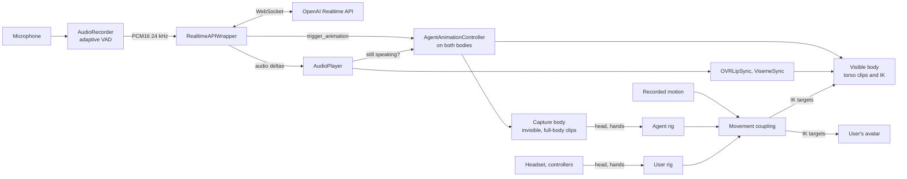

# Embodied AI Agent VR

A Unity platform for embodied AI in VR: a voice-to-voice LLM agent with OpenAI Realtime speech, LLM-selected gestures through function calling, lip sync, and a programmable movement-coupling layer between user and agent.


*Captured in the Unity Editor without a live session: the gestures come from the agent's library and the mouth movement is simulated.*

[Architecture](docs/ARCHITECTURE.md) | [Components](docs/COMPONENTS.md) | [VR setup](docs/VR_SETUP.md) | [Customize](docs/CUSTOMIZE.md) | [Third-party notices](THIRD_PARTY_NOTICES.md) | [Changelog](CHANGELOG.md)

## What it does

- **Talks.** Amy, the agent, listens and answers in speech through the OpenAI Realtime API. An adaptive voice activity detector on the device decides when you start and stop, and you can interrupt the agent.
- **Moves while it talks.** The model calls one tool, `trigger_animation`, with an ordered list of gesture names. A sequencer plays them for as long as the audio plays.
- **Has a face.** OVRLipSync visemes drive the head mesh and are copied to teeth and tongue. The eyes blink.
- **Couples movement.** A layer between tracking and rendering can blend the head and hands of one body towards the mirrored movement of the other: agent follows user, user's avatar follows agent, a recorded source, or no coupling.
- **Supports building on it.** Six user avatars, a motion recorder and player, a movement log, a guided-session controller and a hexagonal room with mirrors. Activities, prompts, boards and durations are set in the Inspector.

## Try it in five minutes

### On a desktop, without a headset

1. Install **Unity 6000.4.4f1** with Unity Hub.
2. `git clone https://github.com/JiahaoLiu5/embodied-ai-agent-vr.git` (about 280 MB of files).
3. In Unity Hub choose **Add project from disk**, select the folder and open it. The first import takes several minutes.
4. Open `Assets/EmbodiedAgent/Demo/DesktopDemo.unity` and press **Play**. If the scene is missing, run the menu command **Embodied Agent > Rebuild Desktop Demo**.
5. You should see Amy in the hexagonal room, a **Gesture preview** panel on the left and a **Conversation** panel on the right. Click a gesture name: Amy plays it. Drag with the right mouse button to orbit, scroll to zoom. No API key is needed up to here.
6. To talk, give the project an OpenAI API key in one of these ways, and never commit it:
   - set the environment variable `OPENAI_API_KEY`, then restart Unity Hub and the Editor, or
   - save the key in a file named `openai_api_key.txt` next to the `Assets` folder (the file is git-ignored).
7. Put on earphones, press **Play**, click **Start conversation** and speak. Amy answers in speech, with lip sync and gestures.

Without a headset the Console may show OpenXR start-up messages; the scene continues without one. To silence them, clear **Project Settings > XR Plug-in Management > Windows > Initialize XR on Startup**.

`Assets/EmbodiedAgent/Scenes/01_ConversationalAgent.unity` can also be started on a desktop, mainly for its debug panel. Without tracking the user's rig stays in its start pose. The panel has a **connect** button, a switch between voice detection and push to talk (space bar), an event list and the agent's transcript.

### Run it in VR

1. Switch the build target to Android. OpenXR with **Meta Quest Support** is already on in this repository.
2. Build `01_ConversationalAgent.unity` to a Quest 3, or press **Play** with the headset linked to the PC.
3. Copy `openai_api_key.txt` to the app's data folder on the headset and allow the microphone.
4. Press **A** on the right controller to start the conversation, and **A** again to end it. Wear earphones.

The full procedure, the settings and a troubleshooting table are in [docs/VR_SETUP.md](docs/VR_SETUP.md).

### Scenes

All scenes are in `Assets/EmbodiedAgent/Scenes` unless noted.

| Scene | What it shows |
| --- | --- |
| `../Demo/DesktopDemo` | Agent, room and gesture panel with an orbit camera, for a desktop |
| `01_ConversationalAgent` | Conversation only; **A** toggles the connection |
| `02_Coupling_Independent` | Guided session, no coupling |
| `02_Coupling_AgentFollowsUser` | The agent's head and hands are blended towards the user's movement |
| `02_Coupling_UserAvatarFollowsAgent` | The user's avatar is blended towards the agent's movement |
| `02_Coupling_RecordedSource` | The user's avatar is blended towards a recorded movement |
| `03_MotionRecording` | As Independent, and writes the agent's head and hands to a CSV file |

In the `02_` and `03_` scenes, X, Y, left trigger, A, B, right trigger (or keys 1 to 6) select an avatar and start the guided session.

## How it works



**Turn taking.** The level of each microphone chunk is measured in dBFS after a high-pass filter that is used only for the measurement. The noise floor is learned while nobody speaks. Speech starts at `max(-50, floor + 12)` dBFS held for 0.08 s and ends after `endSilenceSeconds` below `max(-56, floor + 6)` dBFS. The 0.30 s before the start are kept.

**Two bodies.** The agent's clips animate an invisible body. Its head and hands are sampled like a headset and two controllers. The visible body plays the same clips without head, arm and leg bones; IK places its head and arms from the three sampled points and its legs from foot placement. Scripted gestures and tracked people therefore use the same three-point interface, and the coupling works in both directions.

**Coupling.** With own head `H`, own hand `h`, partner head `H'`, partner hand `h'` (the opposite hand) and ratio `r`:

```text
partner inputs   low-pass filtered: x += (1 - exp(-dt / 0.2 s)) * (x' - x)
M(v)             front-back mirror: v - 2 (v . n) n,  n = forward axis of the Modulation object
head             position H,  rotation Slerp(R_H, M(R_H'), r)
hand position    H + Lerp(h - H, M(h' - H'), r)
hand rotation    blend of R_h and M(R_h') by r, on the arc that continues the previous output
```

The shipped ratio is `r = 0.3`. The user's own camera is never changed. [docs/ARCHITECTURE.md](docs/ARCHITECTURE.md) has the events, the wiring of each mode and the update order.

## Build on it

Voice, body, and coupling are separate layers, so the project can serve as a base for other embodied AI work.

- **Another character.** Change prompt, voice, avatar, and gesture list to make a tutor, coach, guide, or rehearsal partner.
- **More tools.** Add functions next to `trigger_animation`, so that the model can point, move, or change the scene.
- **Another model.** Model name and endpoint are fields. Any server that speaks the Realtime protocol can be used.
- **Embodiment as a design variable.** Let the agent mirror the user, lead the user, or keep its own rhythm, and change the ratio while it talks.

## Make it yours

| To change | Where | Options and defaults |
| --- | --- | --- |
| Personality, style, gesture guide | `RealtimeAPI` object, `System Instructions` | Prompt text; a neutral prompt for "Amy" |
| Voice, model, server | `RealtimeAPI`: `Voice`, `Model`, `Endpoint` | `shimmer`, `gpt-realtime-2.1-mini`, `wss://api.openai.com/v1/realtime` |
| Gestures the model may use | `Gesture Names` and both Animator controllers | 24 names |
| Turn taking | `Audio` object, `AudioRecorder` | VAD, end silence 0.6 s, barge-in on (in the scenes); push to talk |
| Voice detection | `AudioRecorder`, Robust VAD sections | -50 / -56 dBFS, margins 12 / 6 dB, pre-roll 0.30 s |
| Coupling strength | `followRatio` on `Head Modulated`, `Left Hand Modulated`, `Right Hand Modulated` | 0.3; 0 = own movement, 1 = partner's movement |
| Coupling smoothing | `lerpTime` on the three `... Partner Slow` objects | 0.2 s |
| Coupling mode | Scene, or the switches in [CUSTOMIZE](docs/CUSTOMIZE.md) | Independent, Agent follows user, User avatar follows agent, Recorded source |
| User avatars | `SessionController` or `UniversalAvatarLoaderNew` | 6 Avaturn avatars |
| Session steps and durations | `SessionController` | Panels, optional narration clips, gestures, times |
| Recorded motion | `VRMotionPlayback` | 4 CSV files, one picked at random |
| Logged data | `VRMovementDataLog` | 76 columns at 50 Hz |

## Project layout

```text
Assets/EmbodiedAgent/
  Scenes/            six scenes, see above
  Demo/              desktop demo scene, its scripts and the menu command that rebuilds it
  Scripts/Agent/     gesture sequencing, gesture preview, visemes, blinking
  Scripts/Avatar/    avatar swap, IK targets, foot placement
  Scripts/MovementCoupling/   smoothing, mirroring, blending, pose copying
  Scripts/Motion/    motion recorder, motion playback, movement log
  Scripts/Session/   connection button, guided session
  Animations/ Avatars/ Environment/ Input/ Prefabs/ SampleMotion/ UI/
Assets/ThirdParty/   OVRLipSync, TextMesh Pro, desktop debug panel
Packages/com.mapluisch.openai-realtime-api-for-unity/   modified Realtime client and audio
docs/                architecture, components, VR setup, recipes
```

## Requirements

| Item | Version |
| --- | --- |
| Unity | 6000.4.4f1, Windows (OVRLipSync plugins are included for Windows x64 and Android arm64) |
| Universal Render Pipeline | 17.4.0 |
| OpenXR Plugin / XR Interaction Toolkit / XR Hands | 1.16.1 / 3.4.1 / 1.7.3 |
| Input System / Animation Rigging | 1.19.0 / 1.4.1 |
| Unity glTFast / Newtonsoft Json / Unity UI | 6.19.0 / 3.2.2 / 2.0.0 |
| OpenAI-Realtime-API-for-Unity | 1.0.2, embedded and modified |
| Headset | Quest 3 with its Touch Plus controllers |
| Service | An OpenAI account with access to the Realtime API (paid by use) |

## Privacy

The microphone is opened when a scene starts. Nothing is sent before you connect. When you connect, the prompt is sent to OpenAI, and while you are connected so is the audio of each utterance. Read OpenAI's terms and tell everyone who speaks to the agent. The app does not save audio or transcripts. The movement log and the motion recorder write head and hand movement to local CSV files; treat these as personal data.

## Known limits

- In this release the project was opened and compiled in the Unity Editor, the references in scenes and prefabs were checked, and the desktop demo was run in Play mode without a key. The VR scenes were **not** re-run on headsets after the clean-up, and no APK was built. The WebSocket client was tested against a local mock server and was **not** re-run against the OpenAI service.
- There is no echo cancellation. Without earphones the agent can hear itself.
- The voice detection measures energy. Loud noise can start a turn and very quiet speech can be missed.
- After an interruption, a reply that the server is still generating is cancelled only when your utterance is sent. Audio that arrives before that is played while you speak. The server keeps the full text of the interrupted reply.
- Single user, no networking. Head and hands only, no finger tracking, no gaze control. The agent's voice is not spatialised.
- The coupling expects an unrotated `Modulation` object and adds one to three frames of delay to the smoothing.
- On macOS and iOS, lip sync needs Meta's own package.

## Credits

Designed and built by Jiahao Liu (Cornell University, Virtual Embodiment Lab), in collaboration with Eyal Ofek (University of Birmingham). The Realtime client is based on [OpenAI-Realtime-API-for-Unity](https://github.com/mapluisch/OpenAI-Realtime-API-for-Unity) by Martin Pluisch (MIT). More projects: <https://jiahaoliu5.github.io/projects/>.

## Licence and third-party assets

The source code in this repository is under the [MIT licence](LICENSE). The licence does not cover the avatars, animation clips, room assets, fonts, plugins and other third-party content, which keep their own terms. Read [THIRD_PARTY_NOTICES.md](THIRD_PARTY_NOTICES.md) before you reuse or redistribute them.

## Cite

Use the **Cite this repository** button on GitHub ([CITATION.cff](CITATION.cff)), or:

```bibtex
@software{liu_embodied_ai_agent_vr_2026,
  author = {Liu, Jiahao},
  title = {Embodied AI Agent VR},
  version = {1.0.0},
  year = {2026},
  url = {https://github.com/JiahaoLiu5/embodied-ai-agent-vr}
}
```
