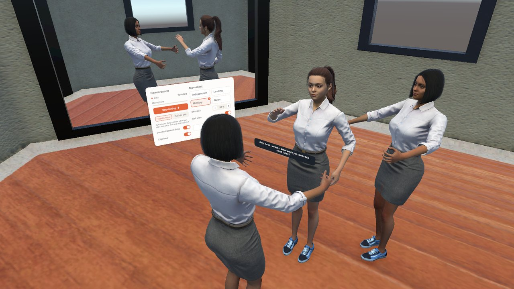
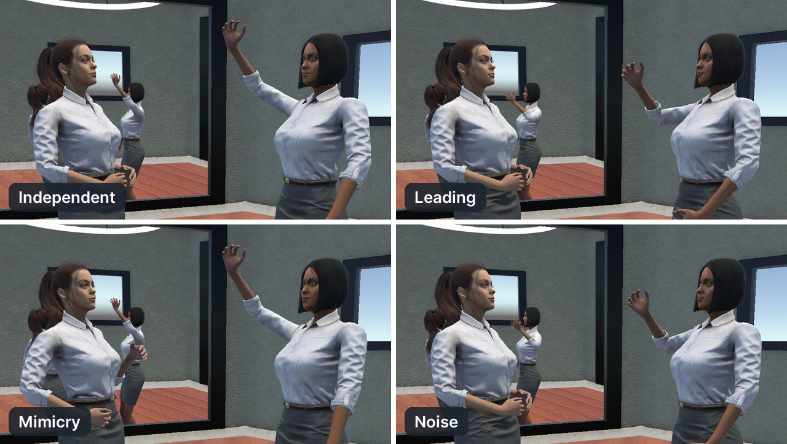
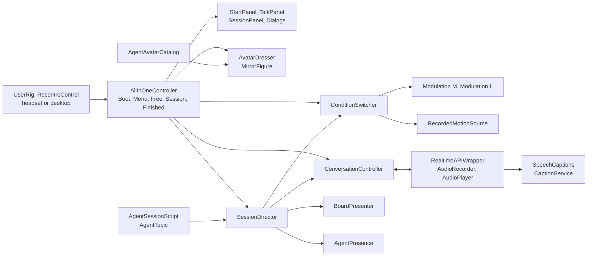

# All-in-One

`Assets/For Demo/Scenes/AllInOne.unity` is the integrated demo: one app in which the user chooses avatar, movement mode, and experience inside VR. This page explains how it is used, how it works, and how to extend it. The voice client, the gestures, and the maths of the movement transformation are described in [ARCHITECTURE.md](ARCHITECTURE.md).

Contents: [User flow](#user-flow), [Panels](#panels), [Movement modes](#movement-modes), [Conversation](#conversation), [Session as data](#session-as-data), [Extend it](#extend-it), [API key](#api-key), [Builds](#builds), [Desktop keys](#desktop-keys), [Architecture of the folder](#architecture-of-the-folder), [Automated tests](#automated-tests), [What was tested](#what-was-tested).

## User flow

1. **Avatar.** Six avatars with pictures. A choice changes the user's own body and a figure beside the panel at once. The figure moves like a reflection. **Recentre** puts the user on the start place.
2. **Movement.** Independent, Leading, Mimicry, or Noise, and the strength. The agent, Amy, is visible and gestures, so every mode can be tried right there.
3. **Experience.** Free conversation, or the full session with one of four topics and a pace.
4. **Start.** Summary, state of the microphone and of the API key, privacy note. Without a key the button reads **Start without conversation**, and Amy gestures on her own.
5. **Free conversation**: Amy greets first. The side panel changes everything that can be changed live. **Full session**: narration, boards, warm-up, preparation time, and a timed conversation; the side panel shows step and time.
6. **Back to the menu** at any time. A running session asks first. The app never has to be restarted.

The app remembers the avatar and whether captions are on. Everything else starts with its default when the app starts. The user stands 1 m in front of Amy with the eyes at 1.71 m. There is no locomotion in VR.



*Free conversation seen from behind the user: side panel, caption, and, at the right, the figure of the self view. Picture of an automated test with a local test server.*

## Panels

| Panel | Contents |
| --- | --- |
| `StartPanel` | The four pages Avatar, Movement, Experience, Start |
| `TalkPanel` (free conversation) | State of the conversation, microphone level, start or stop talking, hands-free or push to talk, "Let me interrupt Amy", captions, movement mode, strength, self view, back to menu |
| `SessionPanel` (full session) | Step, time of the step and of the session, state of Amy, pause, next step, restart, back to menu, "Let me interrupt Amy", captions, self view. Movement mode and strength are fixed while a session runs |
| `Dialogs` | Key help, problem, leave, finished. Only one is shown; the others wait |
| Captions, messages | Between the user and Amy, below and above eye level |

The panels are made in code with the [DemoKit](ARCHITECTURE.md#demokit). They are on layer 1, which the mirrors of the room leave out. In a headset they are used with controller rays, on a desktop with the mouse. In a headset a message says that the side panel is on the left; on a desktop the view turns to it.

## Movement modes

| | Independent | Leading | Mimicry | Noise |
| --- | --- | --- | --- | --- |
| Transformed body | none | user's avatar | agent | user's avatar |
| Transformation object | none | `Modulation L` | `Modulation M` | `Modulation L` |
| Source of the second layer | none | agent | user | a recording |

The share is `ConditionSwitcher.Strength`, 0 to 1, default 0.3. The stepper changes it in steps of 10 percent.



### Switching without jumps

[`ConditionSwitcher`](../Assets/For%20Demo/AllInOne/Scripts/ConditionSwitcher.cs) changes the mode while the scene runs:

1. **Fade out.** The share of the current mode goes to zero in 0.35 s, or longer when it is above 35 percent (at most 100 percent per second).
2. **Prepare.** The next transformation starts with share zero. Its whole chain is computed once (`ModulationUnit.Prewarm`), so that no smoothed pose from earlier is left in it. Then the switcher waits until both hands have settled on a rotation (`IsReady`, at most 120 frames).
3. **Exchange.** In one frame the user's avatar and the agent start to read the other source. At share zero both sources give practically the same pose, so nothing jumps.
4. **Fade in.** The share goes up to the chosen strength.

A newer choice replaces an older one that is still in progress. A change of strength moves by at most 100 percent per second. `Refresh()` starts the mixing again after the user was moved. `SetMode(mode, instant: true)` applies a mode in one frame, for use while the view is covered.

**Noise.** [`RecordedMotionSource`](../Assets/For%20Demo/AllInOne/Scripts/RecordedMotionSource.cs) reads the four recordings of `Assets/Shared/SampleMotion` in the background and picks one at random. They are head and hand movements of the agent's own animation, not of people. In free conversation it starts in the conversation part and skips rests of more than 3 s; in a session it starts at the beginning. It loops with blends of 0.5 s. If the files cannot be read, a message appears and the mode falls back to Independent.

### Mirrors

The room has three mirror cameras of 1600 x 1000. [`MirrorThrottle`](../Assets/For%20Demo/AllInOne/Scripts/MirrorThrottle.cs) hides the panels from them, ends their view after 15 m, and in a build for a headset lets them take turns: each one renders every third frame, into a texture of 800 x 500. With a headset linked to a PC all three render in every frame. Shared materials are not changed. The mirrors are fixed cameras, not planar reflections.

## Conversation

[`ConversationController`](../Assets/For%20Demo/AllInOne/Scripts/ConversationController.cs) opens and closes the connection and the microphone. It computes its state in every frame from its parts (connection, recorder, player), so the order of their events does not matter.

| State | Shown as | Meaning |
| --- | --- | --- |
| `NoKey` | Cannot talk without a key | No API key was found |
| `Offline` | Not connected | No conversation is wanted |
| `Connecting` | Connecting | Also while narration plays, because the microphone is muted then |
| `Listening` | Listening | Amy waits for the user |
| `UserSpeaking` | You are speaking | A turn of the user has begun |
| `Thinking` | Thinking | The answer was requested and is not audible yet |
| `AgentSpeaking` | Speaking | Amy's voice is playing |
| `Suspended` | Paused | The session is paused |
| `Problem` | Not available | A dialog offers Try again, Continue without voice, Back to menu |

- **Greeting.** In free conversation the client sends a short system note, and Amy speaks first, unless the user was faster.
- **Interrupting.** When the user starts to speak, Amy's voice stops, the answer is cancelled on the server and shortened there to what was heard, and late audio, text, and gestures of it are dropped. The switch "Let me interrupt Amy" turns this off; then the microphone is ignored while she speaks.
- **Push to talk.** A on the right controller, or the space bar. The microphone is open only while the button is held.
- **Connection.** A lost connection is opened again once, after 1.5 s; Amy does not remember what was said before. After a second loss the problem dialog appears.
- **Silence.** A free conversation ends after five minutes of silence. When an answer does not come within 20 s, a message says so.
- **Pause.** A paused session keeps the connection for two minutes. When the system pauses the app, a free conversation ends and a session pauses and gives up the connection.
- **Captions.** Amy's words arrive faster than her voice, so the sentence is chosen by the share of audio that was played. Languages that the font does not cover are left out.
- **Voice.** Amy's voice comes from her mouth (spatial, linear fall-off from 2 m to 15 m). The narration is not spatial.

Texts of the service are shortened, and everything that looks like a key is removed before they reach the screen or the log.

## Session as data

The full session is an asset, [`Content/Session.asset`](../Assets/For%20Demo/AllInOne/Content/Session.asset) (`AgentSessionScript`), run by [`SessionDirector`](../Assets/For%20Demo/AllInOne/Scripts/SessionDirector.cs). One clock drives everything, so a session can be paused, skipped forward, and repeated.

| Step | Kind | Full pace | Quick preview |
| --- | --- | --- | --- |
| Get ready | `Wait` | 5 s | 2 s |
| Welcome, with narration | `Wait` | 13 s | 12 s |
| Warm-up instructions, with narration and board | `Wait` | 23 s | 19.5 s |
| Start, with narration | `ClipLength` | length of the clip | same |
| Warm-up: user and Amy move at the same time | `WarmUp` | length of Amy's movements | same |
| Short pause | `Wait` | 3 s | 2 s |
| Preparation, with narration and board | `Wait` | 79 s | 35 s |
| Timed conversation, with narration | `Conversation` | 305 s | 94 s |
| End, with narration | `ClipLength` | length of the clip | same |

The whole session takes 466 s at full pace (the first choice under **Pace**) and 203 s as a quick preview. The spoken instructions of the preview still name the full times. The clock of the conversation starts when the connection is open, has failed, or has taken 10 s. Two boards on the wall remind of the time, 180 s and 60 s before the end, 3 s each; the preview shows only the second one.

A topic is an asset of the type `AgentTopic` in `Content/Topics`:

| Field | Use |
| --- | --- |
| `id`, `title` | Card on the page Experience and title of the side panel |
| `question`, `userPosition`, `agentPosition` | Text below the cards |
| `warmUpBoard`, `instructionBoard` | Prefabs, shown 0.5 m in front of the user. Optional |
| `warmUpActions` | Animator states that Amy plays in the warm-up, in order |
| `instructions` | Prompt of the agent for this topic |
| `studyLetter` | Leave it empty. Only the tests of the shipped topics use it |

The narration and the boards of the shipped topics are in `Assets/For Study`, and test T3 reads that folder, so keep it.

## Extend it

### Add a topic

1. In `Assets/For Demo/AllInOne/Content/Topics` choose **Create > Embodied Agent > Topic** and fill in the fields. Boards are optional; copy one of `Assets/For Demo/UI/Boards/Conversation` as a template.
2. Write the prompt as a text file. Keep the two animation sections of `Content/FreeConversation.prompt.txt`, or the model will not choose movements sensibly.
3. Open `AllInOne.unity` and add the asset to **Topics** on the object `AllInOne` (component `AllInOneController`). If you rebuild the scene with the menu command, also add its name to `TopicFiles` in `AllInOneSceneBuilder`.

### Add an avatar

1. Make a prefab as described in [CUSTOMIZE.md](CUSTOMIZE.md#6-add-a-user-avatar).
2. Add an entry to [`Content/Avatars.asset`](../Assets/For%20Demo/AllInOne/Content/Avatars.asset): id, label, prefab, humanoid definition (from `Male.fbx` or `Female.fbx`), and a picture of 512 x 324. Or add the prefab name to `Prefabs` in `AvatarThumbnailBaker` and run **Embodied Agent > All-in-One > Bake avatar thumbnails**, which renders the pictures and writes the catalog again.

More than six avatars get a second page of cards.

### Change the session, the texts, the agent

- Times, captions, clips, and the order of steps: `Content/Session.asset`. Further steps need no code as long as they use the existing kinds and the two boards.
- Prompt of the free conversation: `Content/FreeConversation.prompt.txt`.
- Texts of the panels: [`AgentDemoTexts`](../Assets/For%20Demo/AllInOne/Scripts/AgentDemoTexts.cs).
- Voice, model, server, gesture names: object `RealtimeAPI`. The prompt of this object is replaced when a conversation starts.

Test T1 compares the shipped content (four topics, six avatars, prompts by checksum). Adapt it when you change the content.

### Menu commands

All in **Embodied Agent > All-in-One**:

| Command | What it does |
| --- | --- |
| Import study content | Reads prompts, boards, narration, and times from the original scenes and writes `Session.asset` and the topics again |
| Bake avatar thumbnails | Renders the pictures and writes `Avatars.asset` again |
| Rebuild scene | Builds `AllInOne.unity` from `02_Independent.unity` and puts it first in the scene list |
| Build for Quest (APK), Build for Windows | See [Builds](#builds) |

## API key

The key is never part of a scene or a build. It is looked up in this order:

1. The field `Api Key` of `RealtimeAPI`. Leave it empty; the build commands stop when it is filled.
2. The environment variable `OPENAI_API_KEY`.
3. `openai_api_key.txt` in `Application.persistentDataPath`.
4. `openai_api_key.txt` next to the `Assets` folder (Editor) or next to the program (Windows build).

On a headset, start the app once so that its folder exists, then:

```text
adb push openai_api_key.txt /sdcard/Android/data/com.jiahaoliu.embodiedaiagentvr.allinone/files/
```

Press **How to add a key** and then **Check again**; a restart is not needed. Delete the file before you hand the headset on. Copying the file was not tried on a headset.

## Builds

| Command | Result | Size |
| --- | --- | --- |
| Build for Quest (APK) | `Builds/EmbodiedAgent-AllInOne.apk`, arm64-v8a, API level 32 to 34 | 264 MB |
| Build for Windows | `Builds/AllInOne-Windows/EmbodiedAgent-AllInOne.exe` | 688 MB |

Package name `com.jiahaoliu.embodiedaiagentvr.allinone`, product name "Embodied AI Agent All-in-One", and the Internet permission are set for the build alone, so the demo installs next to a build of another scene. Afterwards the settings are put back. Switch to the target platform before you build, or use the command line (no `-quit`):

```text
Unity -batchmode -projectPath <folder> -buildTarget Android -executeMethod EmbodiedAgent.AllInOne.Editor.BuildAllInOne.Android
Unity -batchmode -projectPath <folder> -buildTarget Win64 -executeMethod EmbodiedAgent.AllInOne.Editor.BuildAllInOne.Windows
```

`Builds` is ignored by git.

## Desktop keys

The desktop version starts by itself when there is no headset, or with `-desktop` on the command line. A stand-alone headset does not fall back to it. At the start the app waits up to 5 s for a headset that is about to render.

| Input | Action |
| --- | --- |
| Left mouse button | Use a panel |
| Right mouse button | Look around |
| W, A, S, D | Small steps |
| Q, E, or left and right arrow | Turn |
| C | Crouch, or stand up |
| 1 to 7 | Idle, wave, raise left, raise right, raise both, point, talk |
| Space (hold) | Push to talk |
| Tab | Look at the side panel or back at Amy |
| V | View from the side, or back |
| Esc | Back to the menu |
| H | Show or hide the key list |

## Architecture of the folder



| Folder | Contents | Assembly |
| --- | --- | --- |
| `AllInOne/Scripts` | Flow, panels, modes, conversation, session | `EmbodiedAgent.Demo`, namespace `EmbodiedAgent.AllInOne` |
| `AllInOne/Content` | Avatars, session, topics, prompts, thumbnails | |
| `AllInOne/Editor` | Scene builder, importer, thumbnails, builds, tests, local test server | `EmbodiedAgent.AllInOne.Editor` |

Every class is listed in [COMPONENTS.md](COMPONENTS.md#all-in-one). The scene uses the rigs, avatars, room, and transformation objects of `02_Independent`. Most parts above are components of the object `AllInOne`; `AvatarDresser` is on `Skeleton_Rig` and `Mirror Figure`, `MirrorThrottle` on `HexagonEnv`, and `FollowTransform` on `Audio`. Panels, dialogs, and captions are created at run time. The voice client, the gesture sequencing, and the movement scripts are shared with the other demo scenes.

## Automated tests

```text
Unity -batchmode -projectPath <folder> -executeMethod EmbodiedAgent.AllInOne.Editor.AllInOneSmokeTest.Run
```

With graphics and without `-quit`; about five minutes. `-aioTests T4,T9` runs a part. The result (`result.json`) and pictures are written to `Logs/AllInOneTest`; the exit code is 0 or 1. Neither the key nor the microphone of the computer is used.

| Tests | Subject |
| --- | --- |
| T1 to T3 | Content, references and key field of the scene, settings of the movement transformation |
| T4, T24 | Layout of every page, reach and readability of every control from the start place |
| T5 | Avatar changes: meshes, bones, hands, feet, figure |
| T6 to T8, T22 | Mode changes, strength, recorded movement, low frame rate |
| T9 to T11, T21 | Conversation without a key and with a local WebSocket server, interruption, bad connections, lip sync |
| T12 to T14 | Both paces of the session, pause, next step, restart |
| T15, T16, T20, T23 | Back to the menu many times, idle movement, hurried input, scene loaded again |
| T17, T25, T26 | Simulated headset and controllers, cost of the picture |
| T18 | Pictures |

T19 is optional and talks to the real service with the key of the computer: `-aioTests T19 -aioLive question.wav,statement.wav` (16 bit, mono, 24000 Hz).

## What was tested

| Checked | How |
| --- | --- |
| All 25 tests of the table pass | Unity Editor on Windows, batch mode |
| Live conversation with the OpenAI service | Three short runs on a desktop with synthesized speech: greeting, answers with gestures and lip sync, interruption, a timed conversation |
| Smooth switching | Largest change per frame in ten mode changes: 0.9 cm (user's avatar), 2.3 cm (agent) |
| Windows program | Built and started |
| APK | Built; manifest checked. Not installed |

**Reply time in the live runs.** The test feeds in a recorded question and then 1 s of silence. The voice began 0.8 to 1.7 s after that (eight answers). The recordings end with about 0.75 s of silence themselves, so the voice began roughly 2.5 to 3.5 s after the last word. The voice detection had ended the turn about 0.6 s before the silence was over (computed from the recordings), so the voice began about 1.4 to 2.3 s after the end of the turn.

**Not tested: everything on a headset.** That includes the start on a headset, frame rate and memory with six avatars, readability, controller rays, recentring, the microphone permission, the echo of the speakers, and copying the key file. No real voice was used; the microphone path was fed with audio by the test.
