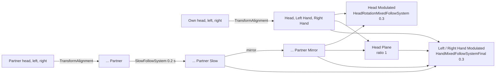

# Architecture

This document describes how the parts of the project work together. [COMPONENTS.md](COMPONENTS.md) lists every script with its fields, and [CUSTOMIZE.md](CUSTOMIZE.md) has recipes.

Contents: [Overview](#overview), [Scenes](#scenes), [Voice pipeline](#voice-pipeline), [Realtime events](#realtime-events), [Gestures](#gestures), [Face](#face), [Two bodies](#two-bodies), [Movement coupling](#movement-coupling), [Avatars and IK](#avatars-and-ik), [Guided session](#guided-session), [Motion files](#motion-files), [Update order](#update-order), [Failure handling](#failure-handling).

## Overview

The application runs on one device for one user. There is no networking apart from the WebSocket to the language model.

| Layer | Main parts | Location |
| --- | --- | --- |
| Voice | `RealtimeAPIWrapper`, `AudioRecorder`, `AudioPlayer` | [`Packages/com.mapluisch.openai-realtime-api-for-unity/Runtime`](../Packages/com.mapluisch.openai-realtime-api-for-unity/Runtime) |
| Agent body | `AgentAnimationController`, two Animator controllers, `VisemeSync`, `EyeAnimationHandlerNew` | [`Assets/EmbodiedAgent/Scripts/Agent`](../Assets/EmbodiedAgent/Scripts/Agent), [`Animations`](../Assets/EmbodiedAgent/Animations) |
| Movement coupling | `Modulation M` prefab with smoothing, mirroring and blending scripts | [`Assets/EmbodiedAgent/Scripts/MovementCoupling`](../Assets/EmbodiedAgent/Scripts/MovementCoupling) |
| User body | `IKTargetFollowVRRig`, `IKFootSolver`, `UniversalAvatarLoaderNew` | [`Assets/EmbodiedAgent/Scripts/Avatar`](../Assets/EmbodiedAgent/Scripts/Avatar) |
| Session | `VRConnectionControllerXRI`, `SessionController` (the guided-session controller) | [`Assets/EmbodiedAgent/Scripts/Session`](../Assets/EmbodiedAgent/Scripts/Session) |
| Motion data | `VRMotionRecorder`, `VRMotionPlayback`, `VRMovementDataLog` | [`Assets/EmbodiedAgent/Scripts/Motion`](../Assets/EmbodiedAgent/Scripts/Motion) |

Important objects in the scenes:

| Object | Role |
| --- | --- |
| `RealtimeAPI` | `RealtimeAPIWrapper` and `VRConnectionControllerXRI`; its child `Audio` has the AudioSource, recorder, player and lip sync |
| `XR Origin (XR Rig) ECA 2` | The user's tracked rig. `Head VR Target`, `Left Hand VR Target` and `Right Hand VR Target` are children of the camera and the controllers with fixed offsets |
| `XR Origin (XR Rig) Mixamo` | The agent's rig. It has the same three targets, filled from the capture body instead of a headset |
| `XR Origin (XR Rig) Mixamo Recording` | A third rig of the same kind, filled by `VRMotionPlayback` |
| `Agent Capture Mixamo` | Invisible agent body |
| `Agent VR Character IK` | Visible agent body |
| `Skeleton_Rig` | The user's avatar |
| `Modulation M`, `Modulation L` | Two instances of the coupling prefab |
| `HexagonEnv` | Room with three mirror cameras, 1600 x 1000 each |

## Scenes

| Scene | Coupling | Session and data |
| --- | --- | --- |
| `Scenes/01_ConversationalAgent` | off | `VRConnectionControllerXRI` on. No guided session, no logging, plain floor |
| `Scenes/02_Coupling_Independent` | off | Guided session, movement log |
| `Scenes/02_Coupling_AgentFollowsUser` | `Modulation M` | Guided session, movement log |
| `Scenes/02_Coupling_UserAvatarFollowsAgent` | `Modulation L` | Guided session, movement log |
| `Scenes/02_Coupling_RecordedSource` | `Modulation L`, partner from a file | Guided session, movement log, `VRMotionPlayback` |
| `Scenes/03_MotionRecording` | off | Guided session, movement log, `VRMotionRecorder` |
| `Demo/DesktopDemo` | off | No guided session, no logging. `DesktopDemo` holds the user's rig in a resting pose |

User and agent stand 1.0 m apart, facing each other along the world z axis.

## Voice pipeline

### Capture and voice activity detection

[`AudioRecorder`](../Packages/com.mapluisch.openai-realtime-api-for-unity/Runtime/Audio/AudioRecorder.cs) opens the microphone as a looping 10 s clip at 24 kHz and reads the new samples every frame, mixed down to mono. With `N` samples in the chunk, `fs = 24000` and `D = N / fs`:

```text
high-pass (first order, measurement only)
    RC = 1 / (2 pi * 80 Hz),  a = RC / (RC + 1/fs)
    y[i] = a * (y[i-1] + x[i] - x[i-1])
power        P = mean(y^2)
smoothing    S = Lerp(S, P, 1 - exp(-D / 0.08 s))
level        L = 10 * log10(max(S, 1e-10))                    dBFS
thresholds   T_start = max(-50, F + 12)
             T_cont  = max(-56, F + 6);  if T_cont >= T_start then T_cont = T_start - 3
noise floor  F starts at -60. While idle, and only if L <= T_start - 3:
             F = Lerp(F, clamp(L, -100, -5), 1 - exp(-D / 1.5 s))
```

- **Start**: `L >= T_start` for 0.08 s without a gap. The last 0.30 s (pre-roll) are put in front, so the first sound is not cut off.
- **End**: `L < T_cont` without a gap for `endSilenceSeconds` (0.6 in the scenes, 1.6 in code), or 120 s of speech.
- Once an utterance has started, all samples are kept, including pauses. The recorded audio is never filtered.
- **Barge-in on** (`interruptResponseOnNewRecording`, on in the scenes): the start of an utterance stops the agent's playback at once.
- **Barge-in off**: while the agent is speaking, detection is suspended and an utterance that has begun is dropped.

A finished utterance is converted to PCM16 little endian, encoded as base64 and raised as `AudioRecorder.OnAudioRecorded`. In `PushToTalk` mode, `StartRecording()` and `StopRecording()` mark the utterance instead.

On Android the recorder asks for the microphone permission. On every platform it tries again every second until a device is available.

### Connection

[`RealtimeAPIWrapper`](../Packages/com.mapluisch.openai-realtime-api-for-unity/Runtime/RealtimeAPIWrapper.cs) opens a `ClientWebSocket` to `<endpoint>?model=<model>` with an `Authorization: Bearer` header. The key is looked up in this order: Inspector field, environment variable `OPENAI_API_KEY`, `openai_api_key.txt` in `Application.persistentDataPath`, and in the Editor also `openai_api_key.txt` in the project folder.

- `ConnectWebSocketButton()` toggles, `Connect()` opens, `Disconnect()` closes, `IsConnected` tells the state.
- Sending is serialised by a lock, so messages that belong together are not mixed with others.
- The receive loop runs on Unity's main thread through `await`, so events may touch scene objects.

### Playback

[`AudioPlayer`](../Packages/com.mapluisch.openai-realtime-api-for-unity/Runtime/Audio/AudioPlayer.cs) collects the audio deltas in a buffer and plays them in clips of up to 2 s (48000 samples). Playback starts when a first delta arrives, and ends when the buffer has stayed empty for 0.1 s. `IsAudioPlaying()` is true while the playback coroutine runs or samples are buffered. The gesture sequencer uses this, because `AudioSource.isPlaying` is false for a moment between two clips.

## Realtime events

Sent by the client:

| Event | When | Content |
| --- | --- | --- |
| `session.update` | Once, right after connecting | `type: realtime`, `instructions`, `audio.output.voice`, `tools` |
| `response.cancel` | A new utterance is sent while the server is still generating | |
| `conversation.item.create` | Utterance finished | User message with one `input_audio` part (the whole utterance) |
| `response.create` | Directly after it | `output_modalities: ["audio"]` |
| `conversation.item.create` | Tool call received | `function_call_output` with `{"status":"success"}` or an error status and message |
| `response.create` | Directly after it | Asks the model to continue |

Not set by the client, so the server defaults apply: audio formats (PCM 24 kHz), server turn detection, temperature, input transcription, tool choice, output limit. The client sends complete utterances as items and does not use the server's input audio buffer.

Handled from the server:

| Event | Effect |
| --- | --- |
| `session.created`, `session.updated` | `OnSessionCreated` (created only) |
| `conversation.item.added` / `.created` / `.done` | `OnConversationItemCreated` once per item |
| `response.created`, `response.done` | Track whether a response is in progress; `OnResponseCreated`, `OnResponseDone` |
| `response.output_audio.delta` | Decoded and passed to `AudioPlayer.EnqueueAudioData` |
| `response.output_audio_transcript.delta` | `OnTranscriptReceived(text)` |
| `response.function_call_arguments.done` | Gestures, see below |
| `response.output_audio.done`, `..._transcript.done`, `response.content_part.*`, `response.output_item.*`, `rate_limits.updated` | Matching C# event |
| `error` | Logged. The message "Cancellation failed: no active response found" is ignored |

Other event types are written to the Console and ignored. The C# events of `RealtimeAPIWrapper` are static. `OnAnimationSequenceReceived(List<string>)` carries the gesture names. Only the agent's speech arrives as text; the user's speech is not transcribed.

A response counts as finished when the server is done **and** its audio has been played.

## Gestures

The tool sent in `session.update`:

```json
{
  "type": "function",
  "name": "trigger_animation",
  "parameters": {
    "type": "object",
    "properties": {
      "animation_sequence": { "type": "array", "items": { "type": "string", "enum": ["...gesture names..."] } }
    },
    "required": ["animation_sequence"]
  }
}
```

The `enum` is the `Gesture Names` list of `RealtimeAPIWrapper`. Each name is the name of a state on the first layer of both Animator controllers. The 24 shipped names:

| Group | Names |
| --- | --- |
| Greeting, agreement | `Waving`, `Head Nod Yes`, `Standing Thumbs Up` |
| Doubt, disagreement, emphasis | `Thoughtful Head Shake`, `Disagreeing Talking`, `Standing Arguing` |
| Thinking, attitude | `Thoughtful Head Nod`, `Cocky Head Turn` |
| Ideas and short reactions | `Talking Ideas (1)`, `Talking Ideas (2)`, `Brief Talking (1)`, `Brief Talking (2)` |
| General speech | `Talking (0)` to `Talking (11)` |

[`AgentAnimationController`](../Assets/EmbodiedAgent/Scripts/Agent/AgentAnimationController.cs) is on both agent bodies and receives the same event:

1. A new sequence replaces the running one. Wait up to 3 s for `AudioPlayer.IsAudioPlaying()`. If there is still no audio, go to `Idle` and stop.
2. For each name: skip it if the Animator has no such state, otherwise `CrossFade(name, 0.2)` and wait for the clip length plus 1 s. Unity reads the 0.2 as a fraction of the current state's length.
3. If the audio is silent for more than 0.3 s, go back to `Idle` (`CrossFade` 0.3) and stop.
4. If the names run out while the agent still speaks, play the fallback gesture `Talking (7)` once, then return to `Idle`.

Both controllers have the same 31 states (24 gestures, `Idle`, six warm-up movements) with clips of the same length, so the two bodies stay in step. Every state except `Idle` has an exit transition to `Idle`; for the 24 gestures it takes 1 s, for the warm-up movements 0.3 s. No parameters and no Any State transitions are used.

## Face

- `OVRLipSyncContext` reads the samples of the `Audio` AudioSource and computes 15 viseme weights (provider Enhanced). `OVRLipSyncContextMorphTarget` writes them to the head mesh of the visible body, smoothing 65, mapped to blend shapes 1-4 and 56-66 of the Avaturn head. The file is changed in one respect: weights are written in the range 0 to 1, because glTFast imports the blend shapes with that range.
- [`VisemeSync`](../Assets/EmbodiedAgent/Scripts/Agent/VisemeSync.cs) copies the weights by blend shape name from the head to the teeth and tongue meshes. It accepts both naming schemes for three vowels (`viseme_I`/`viseme_ih`, `viseme_O`/`viseme_oh`, `viseme_U`/`viseme_ou`).
- [`EyeAnimationHandlerNew`](../Assets/EmbodiedAgent/Scripts/Agent/EyeAnimationHandlerNew.cs) blinks every 3 s on every mesh with `eyeBlinkLeft` and `eyeBlinkRight` (head, eyelashes, eye shading). There is no gaze control.

## Two bodies

The agent consists of two copies of the same avatar.

| | `Agent Capture Mixamo` | `Agent VR Character IK` |
| --- | --- | --- |
| Meshes | All inactive | Visible |
| Animator controller | `AgentAnimatorCore` | `AgentAnimatorCoreTorso` |
| Clips | Full body, 53 animated paths | The same clips with 40 paths: without Head and, on both sides, Arm, ForeArm, Hand, UpLeg, Leg, Foot |
| Head, arms | From the clip | Animation Rigging: multi-parent constraint on the head, two-bone IK on the arms |
| Legs | From the clip | Two-bone IK with `IKFootSolver` |
| Output | Head and hand bones are copied to the agent's rig | What the user sees |

Reason: a person in VR is known to the system only as three points, the head and two hands. By sampling the performance of the capture body at the same three points, the agent becomes a source and a target of exactly the same kind as the user. The coupling layer does not need to know which side is a person, which side is a clip and which side is a file. The torso, shoulders and fingers of the visible body still come from the clips, so the gestures keep their detail.

If you do not need coupling, scenes 01 and 03 contain the inactive object `Agent Capture Mixamo Test`, a single visible body that plays the full-body clips directly. See [CUSTOMIZE.md](CUSTOMIZE.md).

## Movement coupling

### Data flow inside a Modulation object

Each `Modulation` object is an instance of `Modulation M.prefab`. Only its six inputs differ. The root must not be rotated; its forward axis is the line between the two bodies.



### Maths

1. **Smoothing** ([`SlowFollowSystem`](../Assets/EmbodiedAgent/Scripts/MovementCoupling/SlowFollowSystem.cs)). `b = 1 - exp(-dt / lerpTime)`, position with Lerp, rotation with Slerp, `lerpTime = 0.2 s`. The result does not depend on the frame rate. This is a low-pass filter, not a fixed delay.
2. **Head mirror** ([`MirrorTransformRotationHead`](../Assets/EmbodiedAgent/Scripts/MovementCoupling/MirrorTransformRotationHead.cs)). The forward and up vectors of the smoothed partner head are reflected, `v - 2 (v . n) n` with `n` = forward of the Modulation root, and turned into a rotation again. Left/right and up/down reflection can be switched on separately and are off.
3. **Head blend** ([`HeadRotationMixedFollowSystem`](../Assets/EmbodiedAgent/Scripts/MovementCoupling/HeadRotationMixedFollowSystem.cs)). Position = own head. Rotation = `Slerp(own, mirrored partner, 0.3)`.
4. **Hand mirror** ([`MirrorTransformAcrossHeadPlaneNew`](../Assets/EmbodiedAgent/Scripts/MovementCoupling/MirrorTransformAcrossHeadPlaneNew.cs)). Position: reflected across the vertical plane that contains the partner's head and horizontal heading. Rotation: reflected as in step 2.
5. **Hand position** ([`HandMixedFollowSystemFinal`](../Assets/EmbodiedAgent/Scripts/MovementCoupling/HandMixedFollowSystemFinal.cs)).

   ```text
   own      = h - H
   partner  = Yaw(partner heading -> mirrored partner heading) * (mirrored hand - partner head)
   output   = H + Lerp(own, partner, 0.3)
   ```

   `Head Plane` supplies the mirrored heading (head blend with ratio 1). Step 4 followed by this yaw is the front-back reflection of the partner's head-to-hand vector. The own left hand uses the partner's **right** hand and the other way round, as in a mirror.
6. **Hand rotation** (same script). Two candidates are built: own rotation turned by `r` times the short arc towards the mirrored partner rotation, and by `r` times the complementary long arc. The candidate closer to the previous output is used, with 1 degree of hysteresis. This avoids a sudden flip when the two hands pass 180 degrees of difference. At start-up the script outputs the own hand until it has waited 5 frames and then seen 3 stable frames (change of at most 8 degrees), or 90 frames at most. Call `ResetRotationContinuity()` after recentring or regaining tracking.

### Modes

| | Independent | Agent follows user | User avatar follows agent | Recorded source |
| --- | --- | --- | --- | --- |
| `Modulation M` object | off | **on** | off | off |
| `Modulation L` object | off | off | **on** | **on** |
| Own inputs of the active object | | Agent rig | User rig | User rig |
| Partner inputs of the active object | | User rig | Agent rig | Recording rig |
| `Skeleton_Rig`: `IKTargetFollowVRRig` with user rig | on | on | off | off |
| `Skeleton_Rig`: `IKTargetFollowVRRig` with Modulation L outputs | off | off | on | on |
| `Agent VR Character IK`: `TransformAlignment` with agent rig | on | off | on | on |
| `Agent VR Character IK`: `TransformAlignment` with Modulation M outputs | off | on | off | off |
| `Agent Recorder and Playback` and its child `VR Motion Playback` | off | off | off | on |
| `XR Origin (XR Rig) Mixamo Recording` (its `TransformAlignment` off) | off | off | off | on |

Scenes 01 and 03 and the desktop demo use the Independent wiring.

"User avatar follows agent" and "Recorded source" change what the user's avatar looks like, for example in the mirrors. The user's camera follows the headset in every mode.

## Avatars and IK

- **Retargeting**: [`UniversalAvatarLoaderNew`](../Assets/EmbodiedAgent/Scripts/Avatar/UniversalAvatarLoaderNew.cs) (scene 01) and `SessionController` (other scenes) give `Skeleton_Rig` another body. They copy bone positions and scales by bone name (with the alias `LeftEye`/`EyeLeft`), then move every skinned mesh to a child of the same name and connect it to the bones of the same name. The humanoid definition is chosen by the prefab name: "female" or "feminine" first, then "male" or "masculine", otherwise the `forceMale` setting.
- **Body placement**: [`IKTargetFollowVRRig`](../Assets/EmbodiedAgent/Scripts/Avatar/IKTargetFollowVRRig.cs) puts the body under the head (offset 0, -0.54, 0), turns it towards the head's yaw with a frame-rate independent factor, and maps the three targets to IK targets.
- **Feet**: [`IKFootSolver`](../Assets/EmbodiedAgent/Scripts/Avatar/IKFootSolver.cs) casts a ray down and takes a step when the body has moved more than `stepDistance`.
- **Eye height**: `XR Origin (XR Rig) ECA 2` uses the Device tracking origin with a camera offset of 1.71 m in the scenes, so the user's eyes start at the same height for everyone.

## Guided session

[`SessionController`](../Assets/EmbodiedAgent/Scripts/Session/SessionController.cs) runs one coroutine. All panels, clips and times are optional Inspector fields. The release contains no narration clips; the steps keep their durations.

| Step | Content | Scene value | Code default |
| --- | --- | --- | --- |
| Avatar choice | Any of six controller buttons, or keys 1 to 6 | | |
| Load delay | `time0_AvatarLoadDelay` | 5 s | 3 s |
| Welcome | Clip 1, `time1` | 13 s | 5 s |
| Introduction | Clip 2 and panel 1, `time2` | 23 s | 10 s |
| Announcement | Clip 3, for the length of the clip | 0 s without a clip | 0 s |
| Warm-up | The agent plays `familiarizationActions` on both Animators, each for its clip length minus 0.2 s | 6 movements | 4 placeholders |
| Pause | `time3` | 3 s | 3 s |
| Preparation | Clip 4 and panel 2, `time4_PrepDuration` | 79 s | 30 s |
| Conversation | Clip 5, `Connect()`, reminders at 180 s and 60 s before the end, 3 s each | 305 s | 180 s |
| End | Clip 6, `Disconnect()` | | |

## Motion files

**Recorder and playback** (22 columns, decimal point, comma, one header row):

```text
time,
head_px,head_py,head_pz,head_qx,head_qy,head_qz,head_qw,
left_px,left_py,left_pz,left_qx,left_qy,left_qz,left_qw,
right_px,right_py,right_pz,right_qx,right_qy,right_qz,right_qw
```

Time is in seconds from the start, positions are in metres and rotations are quaternions, all relative to `recordSpace` (the `Camera Offset` of the rig). Playback interpolates between rows in real time and writes world poses relative to `playbackSpace`. Recording is limited to `sampleRate` (60 per second in scene 03, 72 in code) and never above the frame rate. Files go to `Assets/VRRecordings` in the Editor (git-ignored) and to `persistentDataPath/VRRecordings` in a build.

In scene 03 the recorder reads the agent's rig. The four files in [`SampleMotion`](../Assets/EmbodiedAgent/SampleMotion) are recordings of the agent's own animation, 475 to 501 s long. The last three letters of a file name give the order of its first warm-up movements: R for the right hand, L for the left hand, N for the neck.

**Movement log** (76 columns, written in FixedUpdate at 50 Hz to `persistentDataPath/VR_Interaction_Movement_Data/Movement_<scene>_<date and time>.csv`):

| Columns | Meaning |
| --- | --- |
| `Frame`, `RelativeTime` | Frame count, seconds since logging started |
| `Distance_XZ` | Horizontal distance between the user's head and the visible agent's head, metres |
| `ViewAngle` | Horizontal angle between the user's head direction and the direction to the agent's head, degrees. Positive: the agent is on the left |
| `RH_*` | User rig: `Head`, `LHand`, `RHand`, each X, Y, Z, Pitch, Yaw, Roll |
| `RA_*` | Agent rig before the coupling |
| `MH_*` | IK targets of the user's avatar after the coupling |
| `MA_*` | IK targets of the visible agent after the coupling |

Rotations are Euler angles in world space. FixedUpdate runs before Update and LateUpdate, so a row holds the poses of the previous frame. Logging starts with one of the six controller buttons; the keyboard does not start it.

## Update order

| Phase | What runs |
| --- | --- |
| FixedUpdate | `VRMovementDataLog` |
| Before Update | Tracking (`TrackedPoseDriver`; also again before rendering) |
| Update | Voice detection, `SlowFollowSystem`, `HeadRotationMixedFollowSystem`, `IKFootSolver`, viseme weights |
| Animation | Animators, then Animation Rigging |
| LateUpdate, order 0 | `TransformAlignment` (all copies), `MirrorTransform...`, `IKTargetFollowVRRig`, `VRMotionPlayback`, `VRMotionRecorder`, `VisemeSync`, blinking. The order among these is not defined |
| LateUpdate, order 10000 | `HandMixedFollowSystemFinal` |

Consequences:

- IK targets written in LateUpdate are used by Animation Rigging in the next frame.
- The blended hands are written after `TransformAlignment` has copied them, so they arrive one frame later than the head.
- The whole chain adds about one to three frames. Use Script Execution Order if you need a fixed number.

`TransformAlignment` also runs in Edit Mode. It writes only real differences, so an aligned scene stays unmodified.

## Failure handling

| Situation | Behaviour |
| --- | --- |
| No API key | Error in the Console with the three places to put a key |
| Connection fails, drops or is closed by the server | Message in the Console, the socket is cleaned up, the same button can connect again. There is no automatic reconnect |
| Unknown tool or malformed arguments | The call is answered with an error status and the model continues |
| Unknown gesture name | Skipped with a warning |
| No microphone or no permission at the start | Retried every second |
| Microphone records at another sample rate | Warning; the audio would be sent at the wrong speed |
| Application quits or the object is destroyed | The socket is closed without waiting longer than 250 ms |
